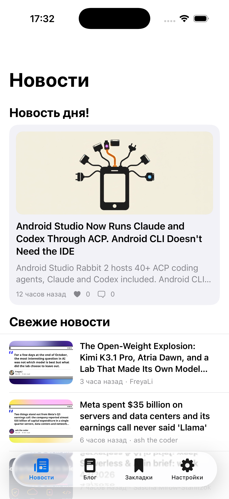
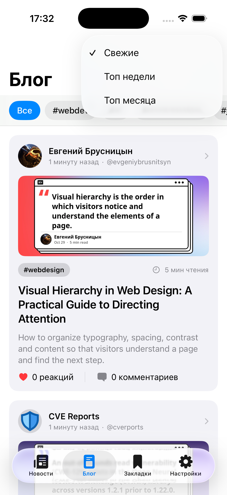
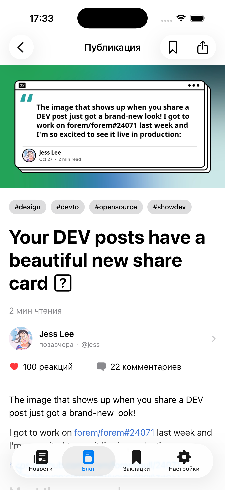
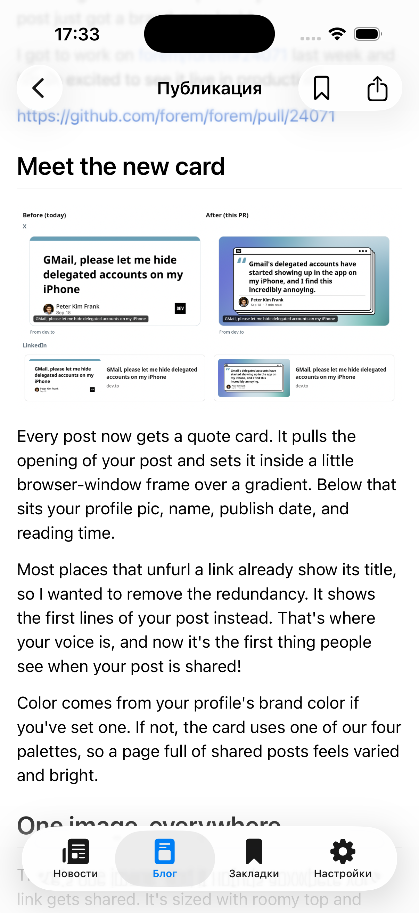
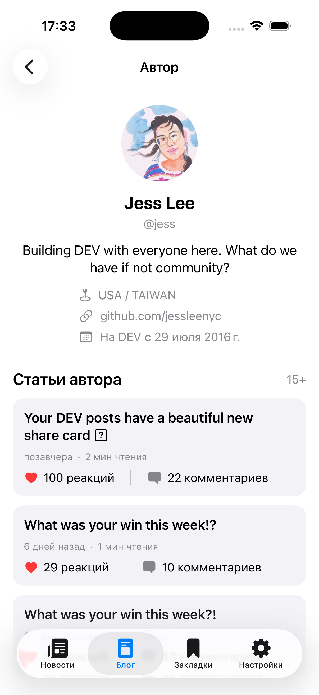
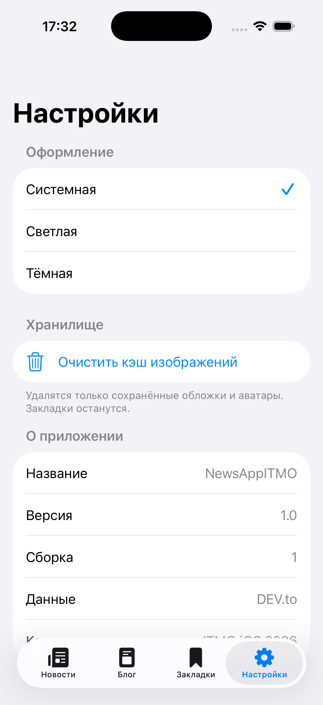
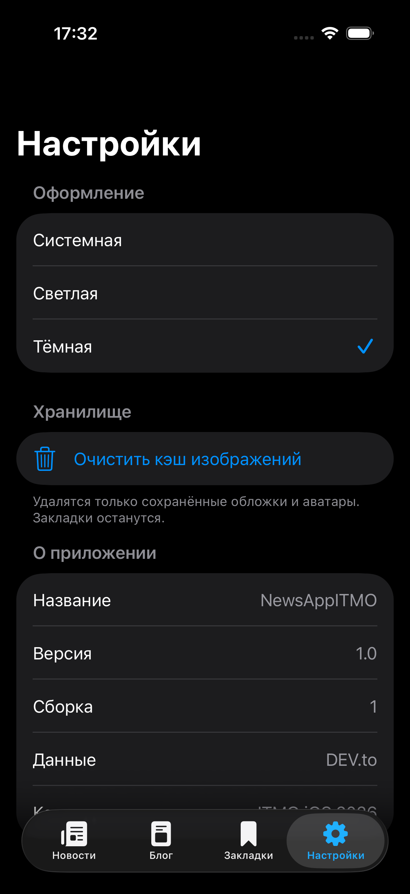

# NewsAppITMO

> **Команда:** Холодов Родион, Гребенкин Никита, Лакеев Георгий.

NewsAppITMO — iOS-приложение для чтения новостей и технических публикаций из [DEV Community](https://dev.to). Проект разработан на SwiftUI в рамках курса по iOS-разработке ИТМО.

Приложение объединяет новостную ленту, блог с фильтрами, полноформатное чтение публикаций, комментарии, профили авторов и локальные закладки для офлайн-доступа.

## Возможности

- новость дня и лента свежих новостей;
- пагинация и обновление данных через pull-to-refresh;
- блог с фильтрацией по тегам;
- сортировка публикаций: свежие, топ недели и топ месяца;
- отображение Markdown и DEV.to Liquid-тегов;
- просмотр комментариев и вложенных ответов;
- профили авторов и список их публикаций;
- сохранение полнотекстовых статей в локальные закладки;
- офлайн-чтение сохранённых публикаций;
- локальный поиск и удаление закладок свайпом;
- системная, светлая и тёмная темы;
- кэширование изображений в памяти и на диске;
- очистка кэша изображений из настроек;
- системный Share Sheet для публикаций;
- состояния загрузки, пустого результата, ошибки и повторного запроса.

## Скриншоты

<table>
  <tr>
    <td align="center"><br><b>Новости</b></td>
    <td align="center"><br><b>Блог и фильтры</b></td>
    <td align="center"><br><b>Публикация</b></td>
  </tr>
  <tr>
    <td align="center"><br><b>Markdown-контент</b></td>
    <td align="center"><br><b>Профиль автора</b></td>
    <td align="center"><br><b>Закладки</b></td>
  </tr>
  <tr>
    <td align="center"><br><b>Поиск в закладках</b></td>
    <td align="center"><br><b>Светлая тема</b></td>
    <td align="center"><br><b>Тёмная тема</b></td>
  </tr>
</table>

## Технологии

- Swift 6;
- SwiftUI;
- Swift Concurrency: `async/await`, `Task`, `actor`;
- Combine для наблюдаемого состояния ViewModel;
- URLSession и Codable;
- NavigationStack и Coordinator;
- NSCache и файловый LRU-кэш;
- JSON-хранилище закладок;
- [MarkdownUI 2.4.1](https://github.com/gonzalezreal/swift-markdown-ui);
- XCTest и XCUITest.

## Архитектура

Проект построен по feature-based архитектуре с MVVM, Coordinator и однонаправленным изменением состояния:

```text
View → Action → ViewModel → Repository → HTTPClient / Storage
                    ↓
                  State → View
```

Сетевые модели не попадают в UI напрямую:

```text
Endpoint → URLSessionHTTPClient → DTO → Mapper → Domain Model
```

Основные архитектурные решения:

- `AppContainer` создаёт общие сервисы приложения;
- `ScreenFactory` собирает экраны и передаёт зависимости;
- Coordinator управляет навигацией и не смешивает её с ViewModel;
- Repository скрывает источник данных от presentation-слоя;
- DTO повторяют контракт DEV.to API;
- Mapper преобразует DTO в независимые domain-модели;
- ViewModel выполняются на `MainActor`;
- хранилища и сетевые репозитории используют actor-изоляцию;
- generation ID и отмена `Task` защищают UI от устаревших ответов.

## Структура проекта

```text
Project/
├── NewsAppITMO/
│   ├── App/                 # Точка входа, DI и корневая навигация
│   ├── Core/
│   │   ├── DomainModels/    # Модели приложения
│   │   ├── Networking/      # HTTPClient, Endpoint и сетевые ошибки
│   │   ├── Storage/         # Закладки и кэш изображений
│   │   └── Types/           # Общие состояния и ошибки
│   ├── SharedData/
│   │   ├── DTO/             # Контракты DEV.to API
│   │   └── Mappers/         # DTO → Domain
│   └── Features/
│       ├── News/
│       ├── Blog/
│       ├── PostDetail/
│       ├── Comments/
│       ├── Author/
│       ├── Bookmarks/
│       ├── Settings/
│       └── CommonUI/
├── NewsAppITMOTests/        # Unit-тесты
├── NewsAppITMOUITests/      # UI-тесты и test host
└── NewsAppITMO.xcodeproj
```

## Источник данных

Приложение использует публичный [DEV.to API](https://developers.forem.com/api). API-ключ для чтения публичных данных не требуется.

Основные запросы:

- `GET /api/articles` — новости, статьи, фильтры и пагинация;
- `GET /api/articles/{id}` — полный текст публикации;
- `GET /api/tags` — популярные теги;
- `GET /api/comments?a_id={article_id}` — комментарии;
- `GET /api/users/{id}` — профиль автора;
- `GET /api/articles?username={username}` — публикации автора.

В `URLSessionHTTPClient` явно отправляется `Accept-Encoding: identity`. Это обход нестабильного кэширования DEV.to CDN: с gzip API иногда возвращал устаревшие ответы, из-за чего свежие статьи могли временно открываться как несуществующие.

## Локальные данные

### Закладки

Закладки сохраняются в JSON-файл в Application Support. Сохраняется полная domain-модель публикации вместе с Markdown-текстом, поэтому ранее загруженную статью можно открыть без сети.

### Изображения

Обложки и аватары проходят через общий `ImageCache`:

1. поиск в `NSCache`;
2. поиск в дисковом кэше;
3. загрузка через URLSession;
4. сохранение в память и на диск;
5. LRU-очистка при превышении лимита.

## Требования

- macOS с Xcode;
- iOS 17.0 или новее;
- Swift 6;
- доступ к интернету для первой загрузки публикаций.

Проект проверялся в Xcode 26.3. Swift Package Manager автоматически загрузит MarkdownUI и его зависимости при первом открытии.

## Запуск

1. Клонировать репозиторий:

   ```bash
   git clone https://github.com/londxz/ITMO-iOS-2026.git
   cd ITMO-iOS-2026
   ```

2. Открыть проект:

   ```bash
   open Project/NewsAppITMO.xcodeproj
   ```

3. Дождаться завершения загрузки Swift Package Manager.
4. Выбрать схему `NewsAppITMO` и симулятор iPhone с iOS 17+.
5. Нажать `Run` (`⌘R`).

## Тесты

Проект содержит unit-тесты ViewModel, маппинга, Markdown/Liquid-преобразований и локального хранилища, а также UI-тесты основных пользовательских сценариев.

Запуск из Xcode: `Product → Test` (`⌘U`).

Пример запуска из терминала:

```bash
xcodebuild \
  -project Project/NewsAppITMO.xcodeproj \
  -scheme NewsAppITMO \
  -destination 'platform=iOS Simulator,name=iPhone 17 Pro' \
  test
```

Название симулятора можно заменить на любое установленное устройство с подходящей версией iOS.

---

Учебный командный проект ИТМО, 2026.
